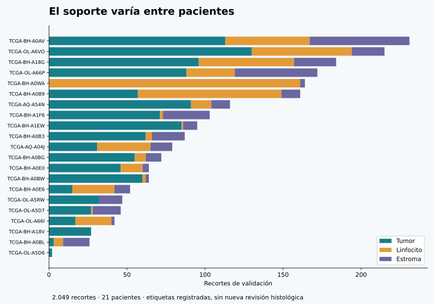

# EDA orientado a decisiones

Se heredan 14.539 recortes / 83 pacientes de train y 2.049 / 21 de validación. La reserva histórica contiene 969 recortes / seis pacientes y ya fue consultada en E1. No se inspeccionan nuevamente sus imágenes en esta ampliación.

Los siguientes resultados proceden de la evidencia heredada `evidencias/eda_heredado/resumen.json`; no son análisis nuevos ni el desempeño de los clasificadores nucleares.

| Hallazgo | Evidencia | Decisión | Impacto y riesgo |
|---|---|---|---|
| Dependencia entre recortes | 104 pacientes de desarrollo | Agrupar remuestreo por paciente | Un recorte no es una observación clínica independiente |
| Dominio train/validación distinguible | Balanced accuracy 0,677; IC95 [0,558; 0,785] | Conservar separación por grupos y reportar desplazamiento | Intervalo sobre predicciones OOF fijas, no incluye reentrenamiento |
| Señal de adquisición por sitio | Balanced accuracy 0,398 en ocho clases / 77 pacientes | Examinar desempeño estratificado por TSS | Evidencia exploratoria de información de sitio; no prueba por sí sola un atajo causal |
| Pacientes atípicos según rasgos de imagen | Cinco train y uno validación sobre umbral p95 de train | Priorizar inspección, no excluir automáticamente | Un valor atípico no demuestra etiqueta errónea |
| Escalas de intensidad y textura | Mediana/IQR calculados en train | Ajustar transformaciones solo con train | Evitar recalcular normalización con validación o reserva |

## Evidencia heredada recuperada en la revisión docente

El capítulo de desarrollo V2 de E1 documenta el análisis de **29.790.411 pares train–validación** mediante dHash de 64 bits, sin candidatos con distancia Hamming ≤4. Ese total coincide con 14.539 × 2.049. Se reutiliza como control previo de la misma partición; no se presenta como un nuevo cálculo. No excluye todas las rotaciones, escalas, solapamientos o similitudes semánticas. Los hashes originales exportados aún deben acompañar la reproducción independiente; la fuente documental se conserva en `evidencias/revision_docente_20261114/EDA_E1_fuente.md`.

| Hallazgo heredado | Valor | Decisión y límite |
|---|---|---|
| Integridad de desarrollo | 16.588 recortes; cero campos críticos vacíos | Conservar identidad por paciente; integridad no certifica etiquetas |
| Balance de clases | Entropía train 1,5068 bits; validación 1,4302 bits | Macro-F1 y resultados por clase; entropía no mide dificultad |
| Razón clase mayor/menor | 2,25 train; 3,22 validación | No interpretar exactitud aislada como mejora |
| Casi duplicados train–validación | 0 candidatos dHash ≤4 en 29.790.411 pares | Control específico heredado; no prueba ausencia de cualquier similitud |
| Clasificador adversarial | AUC registrada 0,7097; balanced accuracy 0,6770 | Reconocer desplazamiento; AUC no recalculada por faltar probabilidades OOF |
| Normalización RGB | Medias 0,63920 / 0,45917 / 0,62775; DE 0,21397 / 0,22150 / 0,17429 | Parámetros de train; no constituyen normalización de tinción |

## Alcance de los controles

Los controles dHash y de dominio se heredan de E1. Esta edición no cuantifica ruido de etiqueta mediante adjudicación independiente ni acredita una prueba de sanidad de sobreajuste de un lote. Estas restricciones limitan la interpretación del EDA; no equivalen a ausencia del control de duplicados heredado.

## Verificación independiente de metadatos de validación · 15 de noviembre

Se recalcularon los conteos a partir de **31 archivos de predicciones** locales. Todos contienen las mismas 2049 identidades únicas, etiquetas y pacientes, sin campos críticos vacíos. Estos archivos no multiplican el tamaño de la muestra: son predicciones repetidas de los mismos recortes. No se inspeccionaron imágenes de reserva.

| Clase | Recortes | Porcentaje | Pacientes con la clase |
|---|---:|---:|---:|
| lymphocyte | 597 | 29.14% | 18 |
| nonTILnonMQ_stromal | 344 | 16.79% | 19 |
| tumor_nonMitotic | 1108 | 54.08% | 20 |

La entropía recalculada es **1.4302 bits** y la razón mayor/menor **3.22**. Hay entre 2 y 231 recortes por paciente; el paciente con más recortes aporta 11.27% del conjunto. 4 pacientes no contienen las tres clases. Por ello, el macro-F1 por paciente con tres clases fijas necesita acompañarse de soporte por clase; no debe interpretarse aisladamente como calidad clínica individual.

La tabla `Validacion_pacientes.csv` explicita los denominadores. La verificación confirma consistencia de los metadatos exportados, **no** integridad de píxeles, ausencia de fuga ni corrección de etiquetas. El dHash heredado sigue siendo un control distinto.

### Protocolo de revisión de etiquetas

Se seleccionaron aleatoriamente 200 recortes de validación, sin condicionar por error del modelo, para una revisión independiente. El formulario conserva la etiqueta original y deja vacíos el dictamen, el motivo y el revisor. Antes de adjudicar, ocultar la etiqueta original al revisor; después comparar y resolver discrepancias con un segundo revisor. Reportar desacuerdo y casos no evaluables, agrupando por paciente. Esta muestra puede diagnosticar discrepancias en validación, pero no estima ruido de entrenamiento ni autoriza cambiar retrospectivamente el benchmark. Las300 muestras de errores del capítulo10 responden a otra pregunta. **No se ha realizado aún la adjudicación histológica.**

## Data Card del conjunto derivado V2

| Campo | Especificación y evidencia |
|---|---|
| Procedencia | NuCLS, imágenes histológicas H&E de cáncer de mama procedentes de TCGA; [artículo primario](https://doi.org/10.1093/gigascience/giac037) |
| Licencia del dataset fuente | CC0 1.0, según [portal oficial](https://nucls.grand-challenge.org/License/), consultado el 15/11/2026. El código del repositorio fuente declara MIT; no confundir ambas licencias |
| Versión utilizada | Derivado local V2, fijado por manifiesto. No se le atribuye un número de versión oficial no verificado |
| SHA256 esperado del manifiesto | `623adf36520751addc324e44cd1b89d95e47842e53cda494914c0248a8be86d4`; valor fijado en el motor y comprobado por el lector de datos |
| Unidad de análisis | Recorte nuclear RGB de 128 × 128 píxeles; paciente como unidad de agrupación |
| Objetivo | Clasificación en tumor_nonMitotic, lymphocyte y nonTILnonMQ_stromal; no representa todas las categorías de NuCLS |
| Particiones heredadas | Train: 14.539 recortes /83 pacientes. Validación: 2.049 /21. Reserva: 969 /6; ya observada en E1 |
| Campos requeridos | archivo, paciente, clase, particion, estado; filas incluidas con identidad y etiqueta válidas |
| Transformaciones | Estadísticos RGB ajustados en train; aumentos y recetas fijados en el código, sin reajuste usando reserva |
| Reproducción | Archivo NuCLS_V2_DATOS.zip y manifiesto coincidente necesarios; el ZIP documental no distribuye imágenes ni pesos |
| Alcance | Experimento académico de clasificación nuclear, sin validación de utilidad clínica ni diagnóstico de pacientes |
| Limitación de procedencia | La cadena completa desde la descarga fuente hasta cada recorte y los archivos primarios dHash no quedan acreditados únicamente por un hash de manifiesto; recuperar sus exportaciones |

La licencia del dataset fuente se verificó en una fuente primaria. Esta ficha no certifica por sí misma la procedencia de cada imagen del derivado local. Se conserva la distinción entre el conjunto original, el subconjunto de tres clases y sus particiones experimentales.

## Anotaciones disponibles y cotejo visual

Se recuperaron imágenes limpias y CSV de anotaciones originales para66 núcleos de validación V2; no requieren volver a etiquetarse. El capítulo [Galería histológica](12_galeria_histologica.md) presenta tres clases, aciertos y discrepancias. Esta verificación automática no sustituye la adjudicación de causas ambiguas, la revisión de100 errores por modelo ni el acuerdo multi-rater.

### Ampliación visual verificada

El archivo QC permitió ampliar el cotejo a2.049 núcleos de21 pacientes y6.147 predicciones. La galería actual reúne36 núcleos de21 pacientes, con18 aciertos y18 discrepancias; sustituye la selección inicial de seis comparaciones de un paciente. Se muestran campos originales y objetivos anotados, no una reconstrucción del recorte usado en Colab.
