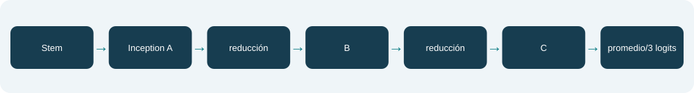
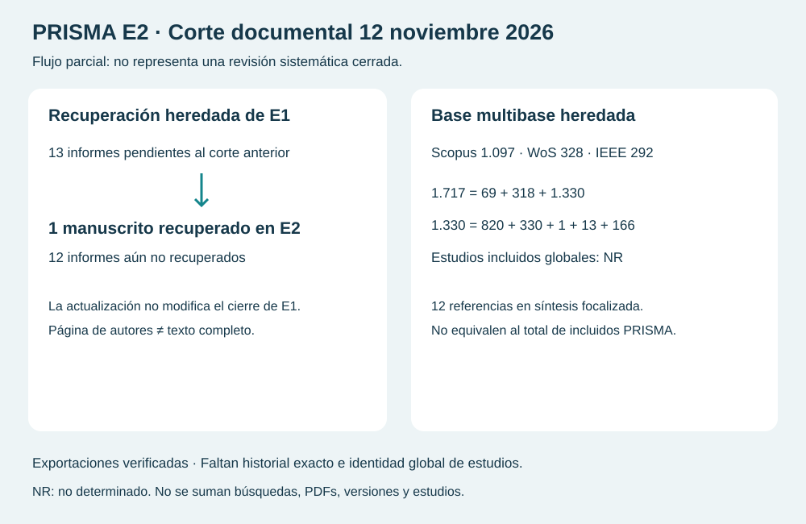

# NuCLS · Estado del arte y selección del Entregable 2

**Corte bibliográfico: 11 de noviembre de 2026. Selección bibliográfica v1, condicionada a perfil GPU.**

La comparación se amplía de tres bases a diez arquitecturas adicionales y dos referencias no profundas. Este documento justifica los candidatos; fundamenta los diez candidatos evaluados con cinco semillas y explicita el alcance de la extensión bibliográfica. Los artefactos y resultados del Entregable 1 permanecen separados.

## 1. Problema, alcance y pregunta

El objetivo experimental es clasificar recortes nucleares de NuCLS en las tres clases ya definidas por el protocolo, manteniendo las particiones por paciente y TSS. Una mejora de accuracy sobre tejidos completos no demuestra una mejora de macro-F1 en núcleos: cambian unidad de observación, etiquetas, contexto, balance y origen de las imágenes.

**Pregunta:** bajo el mismo conjunto de desarrollo y presupuesto declarado, ¿qué mecanismos arquitectónicos mejoran el macro-F1 y la estabilidad frente a ResNet50, y a qué costo computacional? El criterio de relevancia práctica propuesto es δ=0.02; la potencia y el número final de semillas deben recalcularse para los contrastes nuevos.

Las 66 corridas base están completas, con 22 semillas por modelo. En validación: CNN-BN 0.7600±0.0219, DenseNet121 0.7846±0.0217 y ResNet50 0.7922±0.0227 (media±DE). ResNet50−DenseNet121 tiene Δ=0.00765 y p t pareado con Holm=0.1745: no permite afirmar superioridad entre esas dos bases. Son resultados de desarrollo condicionados a la selección, no evidencia clínica independiente. Fuente: análisis local `Estadistica_E2_22`, generado desde el índice de las 66 corridas.

La reserva ya observada en E1 no puede convertirse en una prueba nueva e intacta por cambiar el nombre de la fase. El cierre de E2 confirma que no se volvió a evaluar. Ninguna selección aquí usa nuevas métricas de reserva.

## 2. Evidencia por nivel de proximidad

Se distinguen tres niveles: clasificación de núcleos; clasificación de tejidos o biomarcadores a partir de histología; y diseño general de arquitecturas en imágenes naturales. El tercer nivel aporta mecanismos y reproducibilidad, no validación específica en NuCLS. CellViT pertenece al contexto nuclear contemporáneo, pero resolver segmentación y clasificación conjunta exige una tarea distinta a recibir un recorte RGB ya delimitado. [CellViT](https://doi.org/10.1016/j.media.2024.103143).

La comparación controlada de Springenberg et al. permite separar inicialización desde cero y preentrenamiento. Sus barras reportan error estándar, no desviación estándar. Es una base más útil para diseñar el benchmark que ordenar porcentajes de artículos heterogéneos. [Estudio](https://doi.org/10.1016/j.media.2023.102809).

La evidencia de dominio externo de Cen et al. es relevante para la robustez, aunque predice biomarcadores colorrectales y no clases nucleares. Conservamos su condición de preprint y no equiparamos folds con semillas independientes. [Estudio](https://doi.org/10.48550/arXiv.2302.10406).

La siguiente matriz resume la extracción; los campos completos de reproducibilidad y riesgo están en `Extraccion_estudios_histopatologia.csv`. NR significa no establecido en esta extracción, no ausencia demostrada.

| Estudio / DOI | Tarea y diseño | Resultado relevante | Límite de transferencia |
| --- | --- | --- | --- |
| [H1](https://doi.org/10.1016/j.media.2023.102809) | PCam y cuatro conjuntos de histopatología; clasificación de parches; Particiones de cada dataset; auditoría por paciente pendiente por conjunto | PCam desde cero: accuracy InceptionV3 88.57±0.48%; ConvNeXt-T 78.50±1.72%; Swin-T 80.29±0.39%; ± es error estándar | Moderado: múltiples tareas, pero no núcleos NuCLS; preentrenamiento cambia resultados |
| [H2](https://doi.org/10.48550/arXiv.2302.10406) | Predicción de biomarcadores colorrectales a partir de WSI; MCO desarrollo; TCGA externo; una WSI/paciente; agregación de tiles | MSI AUROC: MobileViT .829 [ .765,.888 ]; Sequencer2D .843 [ .779,.901 ] | Moderado: validación externa favorable; tarea molecular y variantes distintas. Swin reportado 48.84M no es Swin-Tiny |
| [H3](https://doi.org/10.1155/acis/4540418) | PanNuke, clasificación nuclear de cinco clases; Folds 1/2/3 para train/val/test | F1 reportado R50 con contexto 75.89%; sin contexto 70.58%. Promedio de F1 no homologado a macro-F1 NuCLS | Moderado/incierto: problema cercano, pero etiquetas, contexto y preentrenamiento diferentes |
| [H4](https://doi.org/10.3389/fonc.2023.1172234) | Pulmón privado; 780 casos y 8712 imágenes derivadas; tres clases; 7842 train / 870 test; separación por paciente no establecida en extracción | MLP-Mixer accuracy 92.43%; F1 88.97%; no atribuirle los resultados de MIM | Incierto/alto para transferir: datos privados, variante Mixer NR; aumento descrito solo en train; no afirmar fuga comprobada |
| [H5](https://doi.org/10.1016/j.jpi.2024.100377) | BreakHis, ocho clases y análisis binario; 75/15/10%; agrupación por paciente no demostrada en extracción | F1 binario .98; imágenes externas de Internet accuracy <.60 | Incierto: variante Large no valida Small; evidencia explícita de caída externa |
| [H6](https://doi.org/10.1186/s13000-023-01380-2) | 799 imágenes de tiroides, 559 pacientes, seis clases; 70% train+val / 30% test; agrupación por paciente no establecida | ResNeXt50: 202 aciertos de 243 imágenes test; accuracy derivada 83.13% | Incierto: más de una imagen/paciente; no confirmar fuga; cardinalidad/ancho exactos NR |
| [H7](https://doi.org/10.1109/ICAISC56366.2023.10085467) | BreakHis ocho clases; 80/20% tras balanceo; separación por paciente y validación de ajuste no establecidas | DeiT solo F1 97.43%; ensemble 98.12%; no atribuir ensemble a DeiT-Tiny | Incierto/alto: preentrenado y variante DeiT no precisada; no trasladar resultado a Tiny desde cero |
| [H8](https://doi.org/10.1016/j.media.2024.103143) | Segmentación y clasificación de células; No extraída para este contraste | No se utiliza una cifra para clasificar recortes | Fuera del Top10 operativo por tarea/entrada, no por calidad; referente contemporáneo |

## 3. Selección reproducible de los diez candidatos

Se evaluaron **20 candidatos arquitectónicos**, que no equivalen a 20 artículos incluidos por PRISMA. El conjunto es deliberado, construido por rastreo de referencias y búsquedas complementarias; no pretende ser un censo de toda la literatura. Se priorizan 2019–2026; ResNet e Inception se conservan como controles fundacionales con aplicaciones histológicas.

**Elegibilidad operativa de esta fase:** clasificador de recortes RGB, arquitectura definida, variante compacta (cupo de aproximadamente 30M parámetros con cabeza de tres clases), implementación disponible en timm 1.0.22 y sin pesos externos. Estos límites responden al presupuesto actual y restringen el alcance de las conclusiones: no prueban inferioridad de modelos mayores o fundacionales. Una sola variante por artículo fundacional evita gastar dos cupos en MobileViT. Se conserva XXS por menor tamaño, no por rendimiento aún no medido.

El puntaje descriptivo es `S = 20C + 15A + 35E + 20K + 10F`:

- `C`: log(1+citas/año), dividido por el máximo de los elegibles. Año inclusivo desde la primera versión; una sola ficha OpenAlex por obra, sin sumar preprint y conferencia. Captura guardada, no conteo permanente.
- `A`: max(0, 1−(2026−año)/12). Premia actualidad sin eliminar controles antiguos.
- `E`: proximidad y calidad de la evidencia, entre 0 y 1. 0: sin aplicación localizada; 0.3: aplicación indirecta o variante sin precisar y validación limitada; 0.4: modelo nominal coincidente con detalles incompletos; 0.5: familia/escala cercana con prueba externa; 0.6: coincidencia de familia y tamaño o comparador bien identificado; 0.8: variante exacta con repeticiones y comparación desde cero; 1: tarea nuclear directamente comparable. El valor 1 de CellViT solo expresa proximidad temática y no elimina su exclusión por tarea conjunta.
- `K`: 1 para implementación local registrada y reproducible en la versión fijada; 0 si no cumple ese criterio operativo. No se afirma que un artículo sin registro timm carezca de código.
- `F`: inverso del número de candidatos elegibles de la familia. Se maximiza la suma de los diez puntajes con al menos cuatro familias.

El juicio de E y los pesos son explícitos pero subjetivos; no son una escala validada ni un metaanálisis. Se fijaron durante la revisión, antes de obtener resultados del Top10. El código y la instantánea permiten reproducir la decisión. No se suman porcentajes de tareas incompatibles para formar un ranking de rendimiento.

| Modelo seleccionado | Familia | Puntaje | Parámetros E2 (M) | Artículo original |
| --- | --- | --- | --- | --- |
| Swin-Tiny | Atención | 79.43 | 27.516 | [Fuente](https://doi.org/10.1109/iccv48922.2021.00986) |
| ConvNeXt-Tiny | CNN | 75.01 | 27.822 | [Fuente](https://doi.org/10.1109/cvpr52688.2022.01167) |
| MobileViT-XXS | Híbrida CNN-atención | 68.01 | 0.952 | [Fuente](https://doi.org/10.48550/arxiv.2110.02178) |
| InceptionV3 | CNN | 66.90 | 21.792 | [Fuente](https://doi.org/10.1109/cvpr.2016.308) |
| EfficientNet-B0 | CNN | 64.66 | 4.011 | [Fuente](https://doi.org/10.48550/arxiv.1905.11946) |
| ResNet18 | CNN | 63.92 | 11.178 | [Fuente](https://doi.org/10.1109/cvpr.2016.90) |
| Sequencer2D-S | Recurrente | 63.60 | 27.268 | [Fuente](https://doi.org/10.52202/068431-2768) |
| MLP-Mixer-S/16 | MLP visual | 56.34 | 17.475 | [Fuente](https://doi.org/10.48550/arxiv.2105.01601) |
| DeiT-Tiny | Atención | 56.08 | 5.500 | [Fuente](https://doi.org/10.48550/arxiv.2012.12877) |
| MobileNetV3-Small | CNN | 52.95 | 1.521 | [Fuente](https://doi.org/10.1109/iccv.2019.00140) |

**Resultado:** cinco familias: CNN, atención, híbrida CNN-atención, MLP visual y recurrente. CNN residual, eficiente, multirrama y ConvNeXt se cuentan como una sola familia; las variantes no inflan la diversidad.

**Sensibilidad:** nueve candidatos permanecen en los cuatro escenarios probados. MobileNetV3-Small y ResNeXt50 intercambian el último cupo al aumentar el peso de evidencia o diversidad. Su diferencia principal es solo 0.55 puntos; MobileNetV3 no es una ganadora concluyente. Se conserva en la selección principal por el criterio fijado y el costo, con ResNeXt50 como primera alternativa documentada. No cambiar de candidato después de mirar resultados para favorecer una conclusión.

**Cambio respecto al cuaderno provisional:** entran ConvNeXt-Tiny, InceptionV3 y Sequencer2D-S; salen ResNeXt50, MobileViT-XS y ResMLP-S12. La elección de ResMLP como homónimo en otros artículos no prueba uso de la arquitectura de Touvron. La lista bibliográfica se documenta separadamente de los candidatos exploratorios. ConvNeXt-Tiny, InceptionV3 y Sequencer2D-S cuentan con código separado; sus resultados deben verificarse antes de incorporarlos al benchmark.

### Candidatos no seleccionados

| Candidato | Decisión |
| --- | --- |
| resnext50_32x4d | Menor puntaje bajo la regla principal; ver sensibilidad y evidencia |
| mobilevit_xs | Una variante por artículo fundacional; XXS conserva el mecanismo con menor costo |
| resmlp_12_224 | Menor puntaje bajo la regla principal; ver sensibilidad y evidencia |
| vgg16 | Modelo denso de alto tamaño; fuera del cupo compacto operativo de esta fase |
| vit_base_patch16_224 | 85.8M en H2; fuera del cupo compacto operativo de esta fase |
| cmt | Sin implementación registrada en timm 1.0.22; integración y validación adicionales |
| vmamba | No registrado en timm 1.0.22; no confundir con MambaOut |
| cellvit | Segmentación y clasificación conjunta; requiere máscaras y cambia la tarea |
| ctranspath | Representaciones preentrenadas externas; fuera del contraste desde cero |
| uni | Representaciones preentrenadas externas; fuera del contraste desde cero |

## 4. Fichas técnicas de los diez modelos

Las cifras originales se incluyen con su tarea y régimen. **No se comparan numéricamente con macro-F1 NuCLS.** Los parámetros E2 se contaron sobre timm 1.0.22, entrada128 y cabeza3, sin preentrenamiento. Los FLOPs/MAdds citados corresponden al artículo, no al perfil E2. Tiempo, memoria y latencia de GPU siguen pendientes del perfil real. Los diagramas son esquemas propios; no sustituyen la definición completa del código.

### 4.1. ResNet18

[Artículo original: Deep Residual Learning for Image Recognition](https://doi.org/10.1109/cvpr.2016.90). Familia: **CNN**. Implementación: `resnet18`.

BasicBlock [2,2,2,2], canales 64/128/256/512. Conexión residual facilita optimización. Controla profundidad frente a ResNet50 heredado.

**Operación esencial:** `y = ReLU(F(x) + P(x)); P ajusta dimensiones cuando es necesario.`

**Resultado original:** ImageNet, error top-1 27.88%, prueba 10-crop (tabla 2); no compararlo con accuracy single-crop.

**Costo:** 1.8G FLOPs a 224 en la arquitectura original; costo E2 por medir. E2: **11,178,051 parámetros**.

**Aplicación y cautela:** H2; antecedente E1 no contado como nuevo estudio. Reduce profundidad, pero downsampling temprano puede borrar detalle nuclear. Fundacional 2015/2016 justificado como control residual.

### 4.2. MobileNetV3-Small

[Artículo original: Searching for MobileNetV3](https://doi.org/10.1109/iccv.2019.00140). Familia: **CNN**. Implementación: `mobilenetv3_small_100`.

Inverted residual, convolución depthwise, SE y h-swish; variante Small 1.0. Diseño orientado a eficiencia; separa costo de capacidad.

**Operación esencial:** `h-swish(x) = x ReLU6(x+3)/6; SE(X) = X ⊙ sigmoid(W₂ ReLU(W₁ GAP(X))).`

**Resultado original:** ImageNet top-1 67.4%; 2.5M parámetros y 56M MAdds en la tabla principal original a 224.

**Costo:** 56M MAdds originales no equivalen automáticamente a FLOPs ni a latencia T4. E2: **1,520,931 parámetros**.

**Aplicación y cautela:** H5. La aplicación H5 usa Large con cabeza modificada, no Small. Selección por mecanismo y costo, con apoyo de dominio indirecto.

### 4.3. EfficientNet-B0

[Artículo original: EfficientNet: Rethinking Model Scaling for Convolutional Neural Networks](https://doi.org/10.48550/arxiv.1905.11946). Familia: **CNN**. Implementación: `efficientnet_b0`.

MBConv con SE; red base del escalamiento compuesto. Balance de profundidad, ancho y resolución; referencia eficiente frente a redes residuales.

**Operación esencial:** `d=α^φ, w=β^φ, r=γ^φ; αβ²γ²≈2. B0 corresponde al punto base.`

**Resultado original:** ImageNet top-1 77.1%, 5.3M y 0.39B FLOPs (tabla 2).

**Costo:** 0.39B a resolución original; no extrapolar tiempos al entrenamiento de E2. E2: **4,011,391 parámetros**.

**Aplicación y cautela:** H2, familia y tamaño compatibles. Usar B0 a 128 rompe la resolución de referencia; cuatro ajustes no reproducen la búsqueda arquitectónica original.

### 4.4. DeiT-Tiny

[Artículo original: Training data-efficient image transformers & distillation through attention](https://doi.org/10.48550/arxiv.2012.12877). Familia: **Atención**. Implementación: `deit_tiny_patch16_224`.

12 bloques; dimensión 192; 3 cabezas; parches16; sin token de destilación en esta variante. Referencia de atención global compacta.

**Operación esencial:** `Attention(Q,K,V)=softmax(QKᵀ/√d)V; z′=z+MSA(LN(z)); z″=z′+MLP(LN(z′)).`

**Resultado original:** ImageNet top-1 72.2% para Tiny sin destilación; no atribuirle el resultado de modelos mayores.

**Costo:** Atención O(N²D); a128 hay64 parches, frente a196 a224, más CLS. E2: **5,499,651 parámetros**.

**Aplicación y cautela:** H7. E2 omite la receta completa y la destilación del artículo; H7 no identifica Tiny. Rendimiento negativo no refuta toda la familia.

### 4.5. Swin-Tiny

[Artículo original: Swin Transformer: Hierarchical Vision Transformer using Shifted Windows](https://doi.org/10.1109/iccv48922.2021.00986). Familia: **Atención**. Implementación: `swin_tiny_patch4_window7_224`.

Dim96; etapas [2,2,6,2]; atención local y ventanas desplazadas; patch merging. Conecta ventanas vecinas y construye jerarquía espacial.

**Operación esencial:** `W-MSA / SW-MSA alternadas; ventanas de tamaño M: costo de atención O(N M² D).`

**Resultado original:** ImageNet top-1 81.3%, ≈29M y 4.5G FLOPs en tabla 1 original.

**Costo:** Costo aproximadamente lineal en tokens a ventana fija; implementación puede requerir padding. E2: **27,515,901 parámetros**.

**Aplicación y cautela:** H1 exacto; H2 usa otra escala. 128 cambia la geometría y las últimas ventanas; validar adaptación sin prometer equivalencia a224. No contar Swin como CNN adicional.

### 4.6. MobileViT-XXS

[Artículo original: MobileViT: Light-weight, General-purpose, and Mobile-friendly Vision Transformer](https://doi.org/10.48550/arxiv.2110.02178). Familia: **Híbrida CNN-atención**. Implementación: `mobilevit_xxs`.

Convoluciones locales, bloques invertidos y transformadores sobre parches; XXS. Integra sesgo local y comunicación global en una red pequeña.

**Operación esencial:** `Xlocal=Conv(X); Z=Unfold(Xlocal); Y=Fuse(X,Fold(Transformer(Z))).`

**Resultado original:** ImageNet top-1 69.0% y ≈1.3M parámetros en la configuración original XXS.

**Costo:** Costos dependen del despliegue de parches; medir GPU, no inferir latencia por parámetros. E2: **951,987 parámetros**.

**Aplicación y cautela:** H2. H2 evalúa MobileViT de ≈4.94M, no XXS. XS no ocupa un segundo cupo: misma propuesta fundacional.

### 4.7. MLP-Mixer-S/16

[Artículo original: MLP-Mixer: An all-MLP Architecture for Vision](https://doi.org/10.48550/arxiv.2105.01601). Familia: **MLP visual**. Implementación: `mixer_s16_224`.

8 bloques; ancho512; token-MLP y channel-MLP; parches16. Control de mezcla global sin autoatención; no confundir con MIM.

**Operación esencial:** `U=X+[W₂ σ(W₁ LN(X)ᵀ)]ᵀ; Y=U+W₄ σ(W₃ LN(U)).`

**Resultado original:** S/16: top-1 73.83% en tabla 3 bajo preentrenamiento JFT-300M, no desde cero en ImageNet.

**Costo:** Token-MLP depende de N: cambiar224 a128 modifica las matrices y su número de parámetros. E2: **17,475,075 parámetros**.

**Aplicación y cautela:** H4. La evidencia H4 no precisa S/16. E2 desde cero es una adaptación; no reproduce el régimen de datos original.

### 4.8. ConvNeXt-Tiny

[Artículo original: A ConvNet for the 2020s](https://doi.org/10.1109/cvpr52688.2022.01167). Familia: **CNN**. Implementación: `convnext_tiny`.

Etapas [3,3,9,3], canales96/192/384/768; depthwise7×7, LN, GELU. Moderniza la CNN; permite contrastar si atención es necesaria.

**Operación esencial:** `y=x+γ·PW₂(GELU(PW₁(LN(DW₇×₇(x))))).`

**Resultado original:** ImageNet top-1 82.1%, ≈29M y 4.5G FLOPs a224 (tabla 1).

**Costo:** Convolución depthwise reduce costo espacial; parámetros medidos aparte para3clases. E2: **27,822,435 parámetros**.

**Aplicación y cautela:** H1. CNN pura, no una nueva familia híbrida. El régimen desde cero pequeño puede perder ventajas del preentrenamiento.

### 4.9. InceptionV3

[Artículo original: Rethinking the Inception Architecture for Computer Vision](https://doi.org/10.1109/cvpr.2016.308). Familia: **CNN**. Implementación: `inception_v3`.

Ramas paralelas y convoluciones factorizadas; reducción de escala; cabeza auxiliar desactivada en E2. Agregación multiescala, útil para contrastar textura y contexto.

**Operación esencial:** `y=Concat(f₁(x),f₂(x),…,fₖ(x)); una conv n×n se factoriza mediante 1×n y n×1.`

**Resultado original:** Artículo: error top-1 21.2% y top-5 5.6%, evaluación de un modelo/una vista.

**Costo:** ≈5B multiply-adds originales, entrada299; no equiparar con FLOPs medidos a128. E2: **21,791,715 parámetros**.

**Aplicación y cautela:** H1. Fundacional2015/2016 justificado por comparación histológica directa. A128 se reduce mucho la resolución interna; arquitectura ejecutable no implica óptima.

### 4.10. Sequencer2D-S

[Artículo original: Sequencer: Deep LSTM for Image Classification](https://doi.org/10.52202/068431-2768). Familia: **Recurrente**. Implementación: `sequencer2d_s`.

Bloques de BiLSTM vertical y horizontal con fusión de canales y MLP. Familia recurrente; contexto global sin autoatención.

**Operación esencial:** `hᵥ=BiLSTMᵥ(LN(X)); hₕ=BiLSTMₕ(LN(X)); U=X+Linear([hᵥ;hₕ]); Y=U+MLP(LN(U)).`

**Resultado original:** ImageNet top-1 82.3%, ≈28M, 8.4G FLOPs a224 (tabla 1).

**Costo:** El artículo reporta menor throughput que varias alternativas; costo depende de longitud y paralelización. E2: **27,267,843 parámetros**.

**Aplicación y cautela:** H2, tamaño concordante; variante exacta no explicitada. Prueba CPU a128 correcta. GPU/determinismo de LSTM aún deben comprobarse; no prometer rapidez a partir de parámetros.

## 5. Síntesis crítica y brecha comprobable

El corpus revisado respalda comparar mecanismos, pero no demuestra que alguno de estos diez sea óptimo para NuCLS. Las amenazas recurrentes son: reportar un único ajuste, no precisar la variante, particionar imágenes sin demostrar agrupación por paciente, comparar preentrenamiento con entrenamiento desde cero y tratar accuracy o F1 no especificado como macro-F1. La disponibilidad de una arquitectura ejecutable tampoco prueba la equidad del ajuste.

En E2 la brecha verificable se formula de manera acotada: **falta medir, bajo este protocolo de NuCLS, si la ventaja en validación de una arquitectura nueva sobre ResNet50 excede δ=0.02, se sostiene entre semillas y pacientes y compensa su costo.** No se afirma que nadie lo haya estudiado en toda la literatura. La hipótesis se refuta si la mejora es menor, inestable o incompatible con el presupuesto.

La caída de rendimiento de E1 entre validación y reserva motiva el análisis por paciente/TSS. Variar semillas cuantifica aleatoriedad de entrenamiento; no aumenta el número de pacientes. La unidad de remuestreo para generalización debe respetar pacientes y, cuando el tamaño lo permita, sitio. Analizar solo el intervalo más favorable produciría una interpretación incompleta.

El experimento desde cero y resolución128 controla dos fuentes de variación, pero favorece ciertos sesgos inductivos. No reproduce recetas de ImageNet con cientos de épocas, fuerte aumento o destilación. La grilla de cuatro configuraciones es una fase exploratoria limitada; no cumple por sí sola todos los rangos de búsqueda de la guía. Si un óptimo cae en el borde, se reportará y se justificará una ampliación en desarrollo, sin consultar la reserva.

## 6. Mecanismos transferibles para E3

Las fuentes siguientes provienen de otras modalidades. Son propuestas de adaptación, no componentes ya entrenados ni resultados obtenidos.

| Mecanismo / fuente | Origen | Adaptación propuesta | Riesgo |
| --- | --- | --- | --- |
| [Autoatención](https://arxiv.org/abs/1706.03762) | Traducción automática / lenguaje | Q,K,V sobre parches 2D con posición espacial | Atención no garantiza invariancia a rotaciones; costo cuadrático |
| [Convolución + atención](https://arxiv.org/abs/2005.08100) | Reconocimiento de voz, Conformer | Sustituir conv1D temporal por conv2D espacial y controlar tamaño de ventana | Orden temporal no equivale a vecindad bidimensional |
| [Parches y preentrenamiento enmascarado](https://arxiv.org/abs/2211.14730) | Series temporales, PatchTST | Enmascarar parches del train; mantener dependencia RGB | Independencia de canales temporales no justificable automáticamente para RGB |
| [Estado selectivo](https://arxiv.org/abs/2312.00752) | Modelado de secuencias/lenguaje, Mamba | Recorridos 2D multidireccionales, no aplanamiento único sin control | Sesgo del orden de lectura; implementación adicional y comparación de costos |

## 7. Trazabilidad de búsqueda y conciliación PRISMA de E2

E2 extiende la revisión de E1, como establece la sección 3 de la guía. Se reutilizan las exportaciones del 7 de noviembre de Scopus (1.097), Web of Science (328) e IEEE Xplore (292). Los tres originales se localizaron y sus SHA256 coinciden con la procedencia registrada en E1. Se incluyen copias en `base_heredada/`; E1 permanece intacto. No se ha repetido ninguna búsqueda para esta conciliación.

| Etapa heredada | Registros o informes |
|---|---:|
| Identificados en tres bases | 1.717 |
| Fuera del periodo 2018–2026 | 69 |
| Duplicados por DOI retirados | 318 |
| Unidades de cribado | 1.330 |
| Exclusiones explícitas por título/resumen | 820 |
| Derivados a contexto o metodología | 330 |
| Duplicado tardío | 1 |
| Informes con lectura documentada | 166 |
| Informes no recuperados al corte E1 | 13 |

Conciliación: **1.717 = 69 + 318 + 1.330** y **1.330 = 820 + 330 + 1 + 166 + 13**. Las 166 lecturas se clasifican en 21 informes focales, 83 sistemas conjuntos/contextuales, 49 tareas adyacentes, 12 fuentes secundarias y un informe con alerta editorial. Estos son informes y categorías documentales, no un total de estudios independientes incluidos.

En E2 se recuperó el manuscrito de LIT-0747: **13 = 1 recuperado + 12 no recuperados**. Los 12 se mantienen como no recuperados, con motivo individual; no bloquean por sí solos el cierre documental y no se excluyen por pertinencia sin lectura. El corte histórico de E1 no se recalcula. La recuperación nueva no cambia automáticamente sus 166 lecturas ni sus capas de síntesis.

La extensión focalizada contiene 12 referencias de dominio; cuatro coinciden por DOI con E1. No se suman las otras ocho como nuevas sin adjudicar títulos y versiones. Las consultas OpenAlex y el descubrimiento web se conservan como canales complementarios, separados de las tres exportaciones institucionales. Sus totales y PDFs no equivalen a estudios cribados.

**Límites que permanecen:** la consulta comunicada de E1 y las exportaciones no acreditan todos los filtros y cadenas exactas ejecutados en cada plataforma. Falta el historial original, no una repetición obligatoria de la búsqueda. Tampoco existe una cifra global adjudicada de estudios únicos incluidos: se conserva NR. La entrega describe una revisión crítica dirigida con flujo adaptado, sin presentarla como una revisión sistemática exhaustiva plenamente cerrada. No hay segundo revisor independiente ni kappa.

Las consultas propuestas de 2019–2026 se archivan como propuestas no ejecutadas; no sustituyen retrospectivamente el periodo 2018–2026 de la base heredada. La consulta y descarga de 21 PDFs y de textos HTML documentada en los manifiestos se refiere a extracción focalizada, no lectura integral de todos los suplementos.

## Implementación y evidencia experimental

Los diez candidatos cuentan con cinco semillas de validación verificadas; véase [la comparación](13_piloto_diez.md). La selección bibliográfica se conserva independiente del ranking observado.

## 10. Ampliación bibliográfica y conciliación del 11 de noviembre

La síntesis de dominio contiene ahora doce referencias: las ocho fichas anteriores y cuatro extracciones complementarias. Son lecturas focalizadas de métodos y resultados, no una declaración de revisión integral ni el total de estudios incluidos en el PRISMA global.

**Recuperación documentada:** de los trece informes que permanecían no recuperados al corte de E1, se recuperó el manuscrito de autor de LIT-0747; quedan doce sin texto recuperado en esta ampliación. El registro histórico de E1 permanece intacto. Recuperar una versión de autor no certifica identidad de todos sus resultados con la versión editorial.

### H9: Tissue Aware Nuclei Detection and Classification Model for Histopathology Images

Preprint v1, 2025. ConvNeXt y contexto tisular con Virchow-2; PUMA; detección y clasificación por puntos. **Límite de interpretación:** Preentrenamiento y tarea conjunta; no comparación directa con recortes NuCLS desde cero. [Texto consultado](https://arxiv.org/html/2511.13615v1).

### H10: MUSE: Multi-Scale Dense Self-Distillation for Nucleus Detection and Classification

Preprint v2, 2025. Autodestilación local por coordenadas nucleares y contexto multiescala; ajuste posterior para detección y clasificación. **Límite de interpretación:** Utiliza datos de preentrenamiento adicionales; no incorporar sus métricas como resultados del Top 10. [Texto consultado](https://arxiv.org/html/2511.05170v2).

### H11: TME-ContextNet: Class-Conditioned Spatial Supervision and Grouped Decoding for Joint Nuclei Instance Segmentation and Classification

Preprint v2, 2026-11-03. Supervisión espacial condicionada por clase y decodificación agrupada para segmentación y clasificación nuclear. **Límite de interpretación:** Tarea conjunta y supervisión adicional; las métricas de segmentación no equivalen al macro-F1 del clasificador. [Texto consultado](https://arxiv.org/html/2611.02671v2).

### H12 / LIT-0747: A Multi-Scale Conditional Deep Model for Tumor Cell Ratio Counting

Manuscrito de autor v1, 2021. 100 casos pulmonares, 131 ROI; partición 70/10/20 con ROI de una lámina en el mismo subconjunto. Combina detección/clasificación y segmentación tumoral a distintas escalas. **Límite de interpretación:** Umbrales ajustados con train y validación. F1 definido a partir de precisión y recall medios, distinto del promedio de F1 por clase; no comparar directamente con nuestro macro-F1. [Texto consultado](https://arxiv.org/pdf/2101.11731v1).

**Corrección de versiones de H7:** ViT-DeiT cuenta con publicación en ICAISC 2023, DOI [10.1109/ICAISC56366.2023.10085467](https://doi.org/10.1109/ICAISC56366.2023.10085467), confirmada en la [página del laboratorio de los autores](https://tinnguyen-lab.com/home/publication/2023/conference/vit-deit/). El preprint de 2022 es otra versión del mismo estudio: no se cuentan dos estudios. Esta corrección no identifica la variante DeiT como Tiny ni elimina las dudas sobre separación por paciente.

**Síntesis crítica:** estos trabajos refuerzan el interés por contexto multiescala, supervisión espacial y preentrenamiento especializado. No permiten anticipar qué arquitectura vencerá bajo nuestro protocolo común de recortes a128 y entrenamiento desde cero. Se incorporan como contexto y posibles líneas posteriores, sin cambiar los candidatos ni la búsqueda activa.

### Estado del flujo PRISMA E2

| Etapa verificable | Cantidad |
| --- | --- |
| Informes no recuperados al corte histórico E1 | 13 |
| Manuscritos de esos informes recuperados en esta ampliación | 1 |
| Informes heredados aún no recuperados | 12 |
| Referencias de dominio con extracción focalizada en la síntesis E2 | 12 |
| Nuevas exportaciones en esta conciliación (se reutilizan las tres heredadas) | 0 |
| Estudios incluidos en el flujo global E2 | No determinado |

Las tres exportaciones heredadas se verificaron; no se requieren búsquedas repetidas. El total global de estudios únicos continúa no determinado. Se conserva el flujo adaptado de E1 y se documenta por separado la extensión focalizada de E2.

## 11. Conciliación documental del 12 de noviembre

Se cruzaron los DOI de las **12 referencias de dominio** con los 1.330 registros unificados de E1: **4 coincidencias exactas**. Las demás referencias requieren cotejo de títulos y versiones antes de considerarse nuevas; un DOI ausente no prueba novedad. El archivo `Cruce_dominio_E1_E2_20261112.csv` conserva ambas identidades. Este cruce no altera elegibilidad ni el corte de E1.

La búsqueda complementaria volvió sobre cuatro informes pendientes. Se conservaron seis cadenas distintas en `Registro_recuperacion_20261112.csv`; no son seis estudios ni exportaciones de bases. No se verificó una nueva recuperación de texto completo: se mantiene la conciliación **13 = 1 recuperado + 12 no recuperados**.

Para LIT-0791, la [página del laboratorio](https://www.behravans.com/cell-type-count/) describe un encoder InceptionResNetV2 y decodificadores de densidad, conteo y segmentación. La [ficha institucional UEF](https://uef.cris.fi/en/publications/b73a92bf-acb7-4fda-a1c3-08df43df018d) identifica las actas de 2023 y el DOI. Estas fuentes aclaran que su objetivo principal es contar células; no permiten extraer resultados ni sustituir la lectura del artículo. Por tanto, permanece como no recuperado.

### Cómo interpretar conjuntamente la evidencia

La síntesis distingue tres niveles: comparaciones de familias sobre parches histológicos; análisis nuclear con contexto o segmentación conjunta; y predicción sobre láminas con agregación de regiones. Los tres informan decisiones de diseño, pero sus métricas no forman una clasificación común. En particular, accuracy de parches, AUROC de biomarcadores y calidad de segmentación no sustituyen el macro-F1 nuclear de E2.

La selección de diez modelos evalúa mecanismos representativos bajo restricciones explícitas. No prueba que sean los diez más frecuentes ni que los resultados de variantes grandes se transfieran a variantes pequeñas. El reporte separará variante, resolución, preentrenamiento, unidad de partición, número de repeticiones y costo. La falta de una descripción en el artículo se registra como no reportada, no como evidencia de que el control no se realizó.

La comparación final debe mostrar tanto variación entre semillas como incertidumbre por paciente. La reserva histórica ya fue observada en E1: no puede describirse como una prueba inédita. Las decisiones de selección y ajuste siguen limitadas a desarrollo. Ninguna conclusión bibliográfica de esta actualización depende del rendimiento que esté produciendo Colab.

### Cierre documental y límites de E2

La revisión de los originales confirmó que las exportaciones institucionales ya existen y se heredan de E1. Se corrige la indicación anterior de que era obligatorio repetirlas. La sección 7 muestra la conciliación y las copias verificadas. Los 12 no recuperados son una limitación declarada. No se dispone del historial exacto por plataforma ni de la adjudicación global de estudios únicos; no se inventa una cifra global de incluidos.

## Cierre documental verificable · 15 de noviembre

Se comprobó la aritmética del flujo heredado contra los archivos locales: **1.717 =69+318+1.330** y **1.330=820+330+1+166+13**. Las166 fichas conservan21 informes focales,83 contextuales/conjuntos,49 adyacentes,12 secundarios y1 con alerta editorial. No hay DOI repetidos ni títulos exactamente iguales tras normalización dentro de esas166 fichas. Eso **no prueba** que todas representen estudios o cohortes independientes.

Se completó el cotejo de títulos e identificadores para las12 referencias de dominio: cuatro coinciden por DOI con E1; en las otras ocho no hay coincidencia exacta de DOI ni título normalizado en los1.330 registros exportados. No se las convierte automáticamente en ocho estudios nuevos. ViT-DeiT conserva vinculados preprint y congreso; H12 conserva su identidad LIT-0747. Dos pares de títulos similares de las fichas heredadas se revisaron y no se fusionaron automáticamente: DT-Yolact/StarDist son métodos distintos, y STi-HoverNet/TRG-DilatedHoVer presentan variantes diferentes. La independencia de cohortes requiere una comprobación adicional.

Los12 informes no recuperados permanecen declarados. Las consultas dirigidas no produjeron una nueva recuperación verificable; una página de libro, un resumen o un DOI no se contabilizan como lectura del texto completo. El flujo E1 permanece intacto. El historial original de consultas institucionales no puede reconstruirse como ejecutado; esa limitación se explicita, y el total global de estudios independientes permanece sin determinar. El cierre de esta ampliación es **documental y focalizado**, no una revisión sistemática exhaustiva nueva.

### Tres búsquedas transversales ejecutadas

El registro del15 de noviembre conserva tres cadenas reales de búsqueda web y los accesos posteriores a fuentes primarias. No se presentan como búsquedas institucionales ni como parte del denominador heredado de1.717 registros. Las tres referencias siguientes forman una síntesis de mecanismos separada de las12 referencias histológicas y del Top10; no cambian las arquitecturas en ejecución.

| Fuente y modalidad | Mecanismo observado | Propuesta para histopatología y límite |
|---|---|---|
| [Conformer](https://www.isca-archive.org/interspeech_2020/gulati20_interspeech.pdf) · Voz | Combina convolución local con atención global (Sección2, encoder) | Bloques híbridos para morfología local y contexto tisular. La estructura temporal de voz no equivale a la geometría2D; requiere experimento independiente |
| [S4](https://arxiv.org/html/2111.00396v3) · Secuencias y series temporales | Estado estructurado para dependencias largas (Sección3; apéndiceD.3.5) | Procesamiento de secuencias de parches con posición2D explícita. Sensibilidad al recorrido de parches; resultados de pronóstico no validan clasificación nuclear |
| [DistilBERT](https://arxiv.org/html/1910.01108v4) · Lenguaje | Distilación de distribuciones y representaciones de un docente (Secciones2–3) | Comprimir un clasificador histológico usando solo datos de desarrollo. Puede heredar sesgos del docente; las mejoras de lenguaje no se trasladan numéricamente a NuCLS |

Las propuestas de transferencia son inferencias de diseño, no resultados demostrados en NuCLS. La elección del Top10 sigue fundamentada en las fichas de dominio y en la regla de puntuación previamente documentada.

### Conclusión del estado del arte

La evidencia disponible favorece contrastar sesgos inductivos y contexto, pero no permite ordenar arquitecturas por cifras tomadas de tareas distintas. Clasificar un recorte nuclear, tipificar una instancia detectada y predecir un biomarcador de una lámina tienen unidades, etiquetas y métricas diferentes. La pregunta de E2 permanece: bajo la partición heredada y un presupuesto declarado, qué modelos mejoran el macro-F1 y con qué estabilidad, costo y degradación entre validación y reserva. Las recetas comunes igualan intentos, pero no neutralizan diferencias de preentrenamiento, resolución o ajuste por familia.

Los archivos de conciliación, cotejo de identidades, consultas y mecanismos se conservan en `evidencias/cierre_documental_20261115/`.
