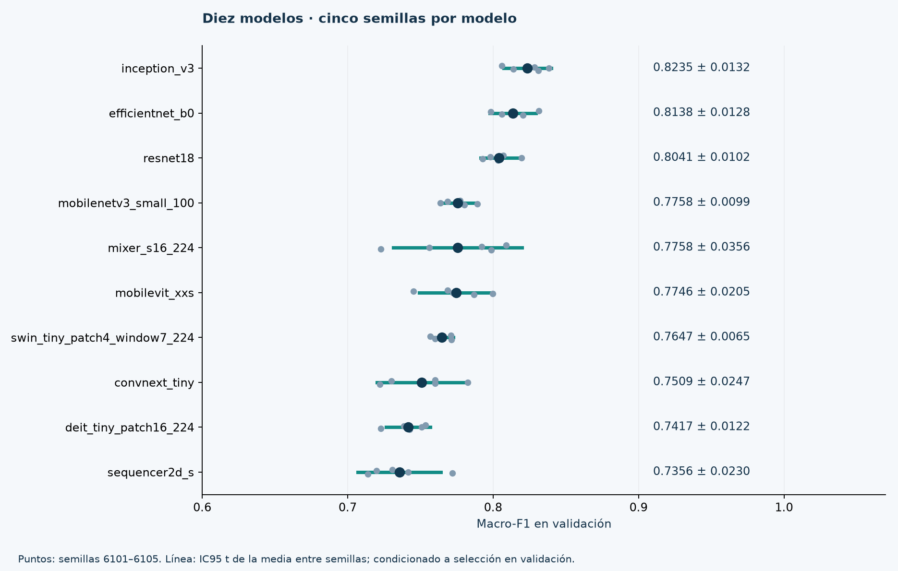
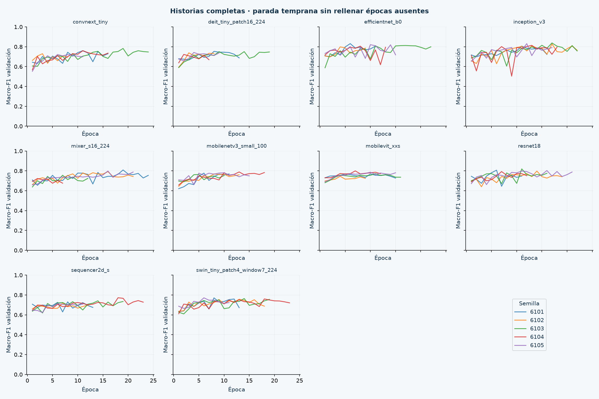
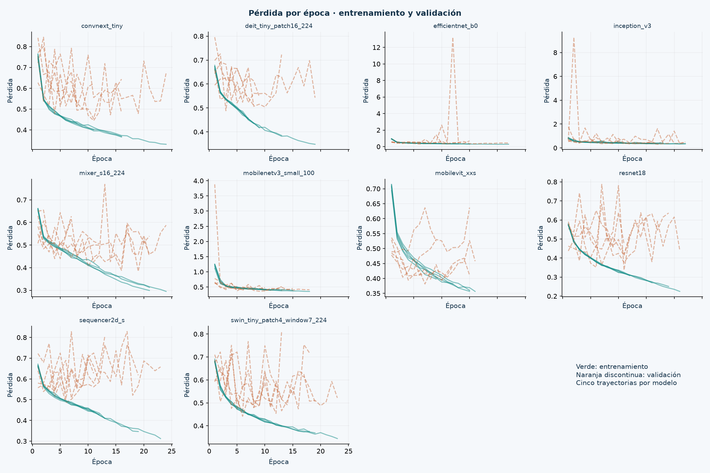

# Diez modelos: resultados con cinco semillas

Se verificaron 50 corridas y 102.450 predicciones, sobre 2.049 recortes de 21 pacientes de validación. Las matrices de confusión y macro-F1 coinciden con los resultados guardados; las historias son continuas y la época seleccionada coincide con el máximo registrado.

|Modelo|Media macro-F1|DE|IC95 entre semillas|
|---|---:|---:|---|
|inception_v3|0.8235|0.0132|[0.8072; 0.8399]|
|efficientnet_b0|0.8138|0.0128|[0.7979; 0.8296]|
|resnet18|0.8041|0.0102|[0.7915; 0.8168]|
|mobilenetv3_small_100|0.7758|0.0099|[0.7634; 0.7881]|
|mixer_s16_224|0.7758|0.0356|[0.7315; 0.8200]|
|mobilevit_xxs|0.7746|0.0205|[0.7492; 0.8000]|
|swin_tiny_patch4_window7_224|0.7647|0.0065|[0.7566; 0.7727]|
|convnext_tiny|0.7509|0.0247|[0.7202; 0.7817]|
|deit_tiny_patch16_224|0.7417|0.0122|[0.7265; 0.7569]|
|sequencer2d_s|0.7356|0.0230|[0.7070; 0.7642]|

## Interpretación

Inception V3 presenta la mayor media descriptiva (0,8235), seguido de EfficientNet B0 (0,8138). Este orden no acredita superioridad estadística ni cambia el baseline ResNet50. Los intervalos t de la media describen variación entre cinco semillas sobre una partición fija, condicionada a la selección de hiperparámetros y época en validación. No son intervalos de generalización a pacientes nuevos. El piloto no demuestra potencia suficiente para equivalencia.

## Curvas de aprendizaje

## Costos y calibración

Los valores de Brier, ECE con diez intervalos, parámetros, tiempos registrados y latencia reportada se incluyen en [la tabla completa](../evidencias/piloto_diez_20261115/resumen.csv). Los tiempos acumulados son los registrados por las corridas, no una medición del tiempo total de pared incluyendo desconexiones; la latencia no reemplaza un perfilado homogéneo.

## Evidencia

[Verificación](../evidencias/piloto_diez_20261115/verificacion.json) · [Métricas por corrida](../evidencias/piloto_diez_20261115/metricas_recalculadas.csv). La evaluación presentada corresponde a validación. La reserva histórica, ya consultada en E1, se distingue de esta evaluación de desarrollo.
