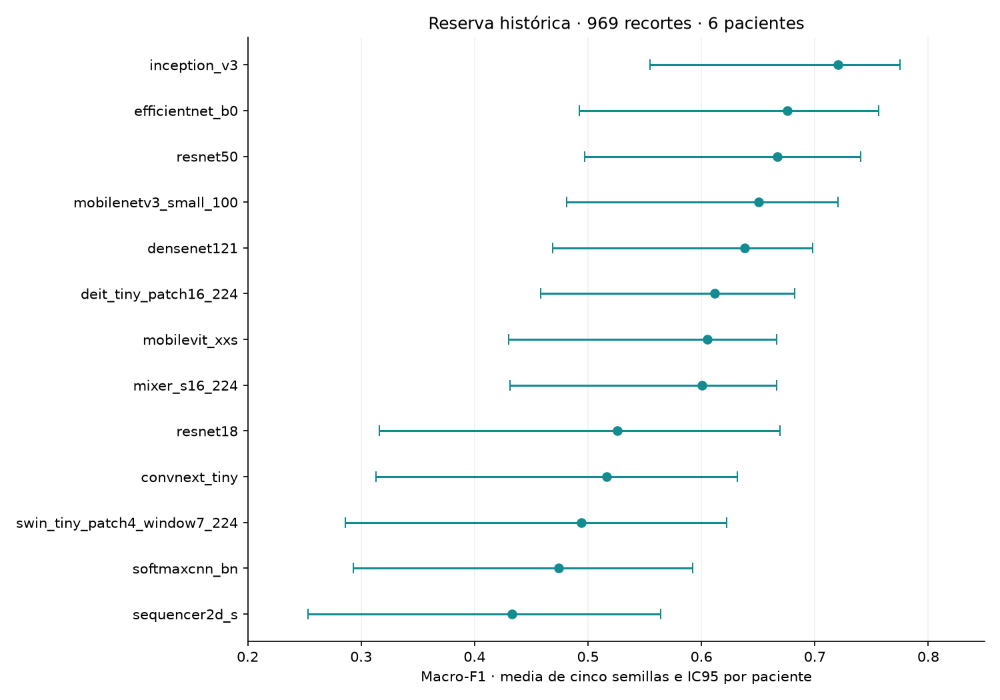

# Cierre de reserva y estadística

**Actualización online: 16 de noviembre de 2026.** Complemento posterior a la entrega del 15 de noviembre. El archivo entregado conserva su versión original.

## Diseño y alcance

El cierre reúne **65 evaluaciones: 13 modelos × 5 semillas comunes (6101–6105)** sobre **969 recortes de seis pacientes**. Se utilizan los modelos congelados del desarrollo, con ResNet50 como baseline heredado. La reserva ya había sido consultada en E1; no constituye una prueba inédita ni una validación externa. No se seleccionan hiperparámetros con estos resultados.

Las 22 semillas de las bases en validación pertenecen al análisis de desarrollo. El contraste de reserva usa cinco semillas comunes por modelo; los dos análisis tienen denominadores distintos.

## Resultados en reserva

| Modelo | Macro-F1 medio | DE entre semillas | IC95 por paciente |
|---|---:|---:|---|
| inception_v3 | 0.7204 | 0.0333 | [0.5546; 0.7753] |
| efficientnet_b0 | 0.6758 | 0.0312 | [0.4921; 0.7564] |
| resnet50 | 0.6669 | 0.0349 | [0.4972; 0.7402] |
| mobilenetv3_small_100 | 0.6504 | 0.0298 | [0.4812; 0.7202] |
| densenet121 | 0.6379 | 0.0600 | [0.4686; 0.6978] |
| deit_tiny_patch16_224 | 0.6117 | 0.0282 | [0.4583; 0.6823] |
| mobilevit_xxs | 0.6053 | 0.0722 | [0.4302; 0.6664] |
| mixer_s16_224 | 0.6007 | 0.0269 | [0.4312; 0.6662] |
| resnet18 | 0.5260 | 0.0654 | [0.3161; 0.6692] |
| convnext_tiny | 0.5162 | 0.0269 | [0.3133; 0.6314] |
| swin_tiny_patch4_window7_224 | 0.4942 | 0.0499 | [0.2859; 0.6222] |
| softmaxcnn_bn | 0.4742 | 0.0619 | [0.2933; 0.5924] |
| sequencer2d_s | 0.4332 | 0.0492 | [0.2530; 0.5641] |

Los intervalos por paciente proceden de 2.000 remuestreos agrupados; cada remuestreo conserva juntos los recortes de cada paciente y se promedia el resultado de las cinco semillas. Con seis pacientes, su generalización es limitada. La DE entre semillas mide otra fuente de variabilidad.

## Comparaciones con ResNet50

InceptionV3 obtiene **0,7204**, frente a **0,6669** de ResNet50: diferencia de **0,0535** (5,35 puntos). Su IC95 bootstrap agrupado es **[0,0299; 0,0777]**, sin ajuste por multiplicidad. El t pareado tiene p=0,0312 sin ajuste y **p=0,1871 tras Holm** para diez comparaciones; Wilcoxon ajustado da **p=0,6250** y la permutación por paciente ajustada **p=0,3125**. Por tanto, el mejor promedio no acredita superioridad bajo el análisis corregido.

| Candidato − ResNet50 | Δ macro-F1 | p t Holm (10) | p Wilcoxon Holm (10) | IC95 Δ por paciente, sin ajuste |
|---|---:|---:|---:|---|
| resnet18 | -0.1410 | 0.0323 | 0.6250 | [-0.2678; 0.0018] |
| mobilenetv3_small_100 | -0.0166 | 0.7700 | 1.0000 | [-0.0370; 0.0168] |
| efficientnet_b0 | +0.0089 | 0.7700 | 1.0000 | [-0.0041; 0.0355] |
| deit_tiny_patch16_224 | -0.0552 | 0.3794 | 0.6250 | [-0.0818; -0.0198] |
| swin_tiny_patch4_window7_224 | -0.1728 | 0.0436 | 0.6250 | [-0.3177; -0.0445] |
| mobilevit_xxs | -0.0616 | 0.7700 | 0.9375 | [-0.1179; -0.0066] |
| mixer_s16_224 | -0.0662 | 0.2741 | 0.6250 | [-0.0974; -0.0332] |
| convnext_tiny | -0.1508 | 0.0327 | 0.6250 | [-0.2841; -0.0427] |
| inception_v3 | +0.0535 | 0.1871 | 0.6250 | [0.0299; 0.0777] |
| sequencer2d_s | -0.2337 | 0.0022 | 0.6250 | [-0.3825; -0.0723] |

Friedman entre los 13 modelos, con semillas como bloques, da χ²=48,6857 y p=0,00000237. La diferencia crítica de Nemenyi al 95 % es 8,1595 rangos; la matriz completa está disponible en la evidencia. El contraste global no identifica por sí solo superioridad de un candidato sobre ResNet50.

Para InceptionV3 frente a ResNet50, d_z=1,4564, con IC bootstrap [1,1992; 8,1280]. El intervalo amplio evidencia la fragilidad de cinco pares. La mejora mínima detectable estimada con la dispersión observada y α=0,005 es 0,1159; el margen de relevancia práctica permanece en δ=0,02. Esta estimación retrospectiva no demuestra potencia prospectiva suficiente. Ausencia de significación no equivale a equivalencia.

## Calibración, referencias y diagnósticos

El cierre conserva por semilla AUC, AP, MCC, Brier, ECE fijo y adaptativo, pendiente e intercepto de calibración, además de métricas por paciente y sitio. La clase mayoritaria se evalúa con la regla de train y la regresión logística con el modelo guardado, sin reajuste. DeLong y McNemar son diagnósticos que tratan recortes como independientes; no sustituyen la inferencia agrupada por paciente.

## Evidencia descargable

- [Resumen de reserva](../evidencias/cierre_reserva_20261116/resumen_reserva.csv)
- [Métricas por semilla y calibración](../evidencias/cierre_reserva_20261116/metricas_por_semilla.csv)
- [Contrastes, efectos, potencia y Holm](../evidencias/cierre_reserva_20261116/contrastes_vs_resnet50.csv)
- [Nemenyi](../evidencias/cierre_reserva_20261116/nemenyi.csv)
- [Métricas por paciente](../evidencias/cierre_reserva_20261116/metricas_por_paciente.csv)
- [Métricas por sitio](../evidencias/cierre_reserva_20261116/metricas_por_tss.csv)
- [Comparaciones con referencias](../evidencias/cierre_reserva_20261116/contrastes_referencias_paciente.csv)
- [Verificación de publicación y hashes](../evidencias/cierre_reserva_20261116/verificacion_publicacion.json)

Las 65 matrices de confusión reproducen el macro-F1 registrado; medias, desviaciones, Friedman, t pareado y Holm fueron recalculados para esta publicación. Los demás resultados se incorporan de los archivos del cierre. Esta actualización no incorpora resultados de los experimentos posteriores que seguían en ejecución.

Consultar también [calibración, generalización y costo](15_calibracion_costo.md), con gráficos y tablas del mismo cierre.
