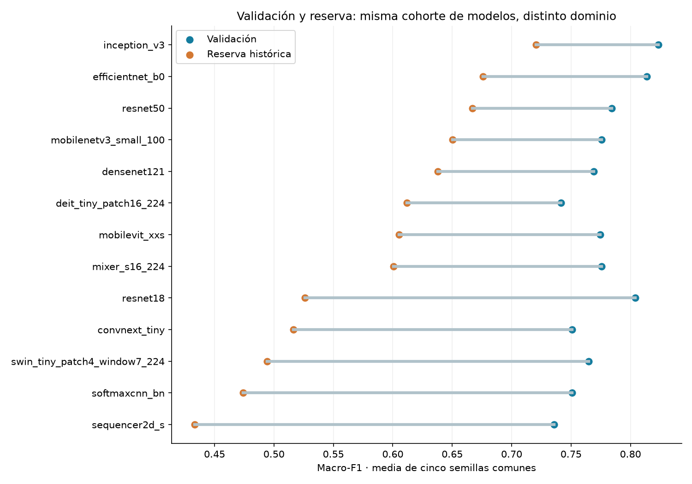
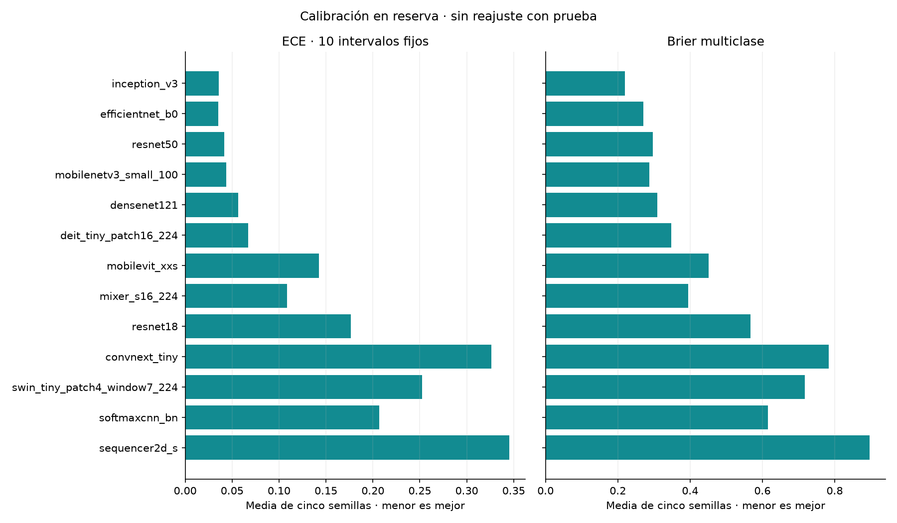
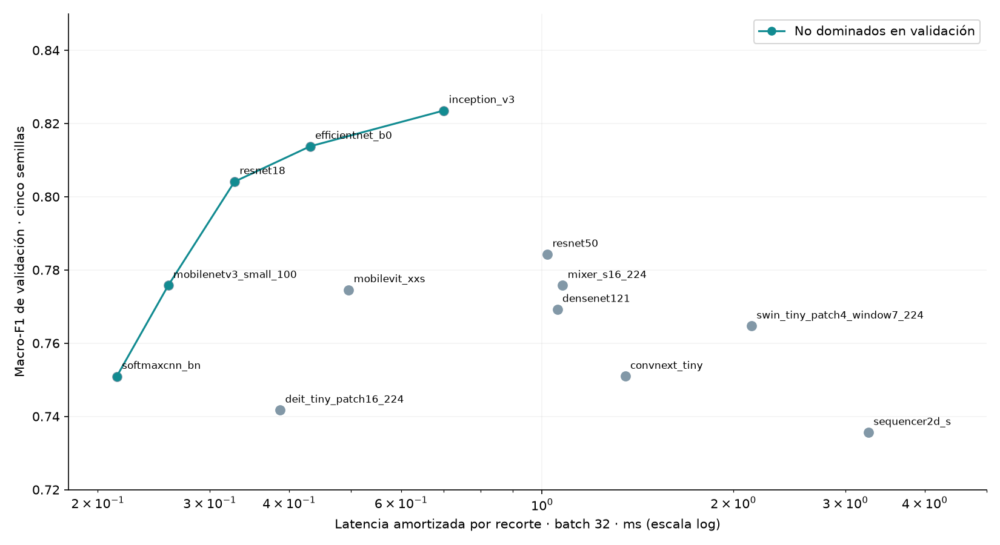

# Calibración, generalización y costo

**Actualización online · 16 de noviembre de 2026.** Análisis descriptivo de las 65 evaluaciones guardadas del cierre. No incorpora resultados de PCam ni nuevos entrenamientos.

## Caída de validación a reserva

Las medias usan las mismas cinco semillas (6101–6105). InceptionV3 pasa de 0,8235 a 0,7204 (caída de 0,1031), ResNet50 de 0,7843 a 0,6669 (0,1173) y ResNet18 de 0,8041 a 0,5260 (0,2781). El orden de los modelos cambia entre particiones. Esto es compatible con diferencias de dominio, composición y soporte; no demuestra por sí solo su causa.

La validación tiene 2.049 recortes de 21 pacientes y la reserva 969 recortes de seis pacientes. Se mantiene separado el análisis de desarrollo con 22 semillas de las bases. La columna train limpio utiliza inferencia sin augmentación: no equivale a la pérdida observada durante entrenamiento.

## Calibración y discriminación

| Modelo | AUC macro | MCC | Brier | ECE fijo | ECE adaptativo |
|---|---:|---:|---:|---:|---:|
| inception_v3 | 0.9263 | 0.6444 | 0.2195 | 0.0356 | 0.0360 |
| efficientnet_b0 | 0.8919 | 0.5833 | 0.2713 | 0.0350 | 0.0399 |
| resnet50 | 0.9025 | 0.5589 | 0.2975 | 0.0416 | 0.0424 |
| mobilenetv3_small_100 | 0.8672 | 0.5413 | 0.2871 | 0.0440 | 0.0455 |
| densenet121 | 0.8876 | 0.5461 | 0.3097 | 0.0567 | 0.0577 |
| deit_tiny_patch16_224 | 0.8632 | 0.4826 | 0.3480 | 0.0669 | 0.0649 |
| mobilevit_xxs | 0.8638 | 0.5057 | 0.4510 | 0.1423 | 0.1435 |
| mixer_s16_224 | 0.8844 | 0.4891 | 0.3946 | 0.1085 | 0.1103 |
| resnet18 | 0.8667 | 0.4192 | 0.5666 | 0.1763 | 0.1778 |
| convnext_tiny | 0.8676 | 0.4043 | 0.7840 | 0.3261 | 0.3280 |
| swin_tiny_patch4_window7_224 | 0.8599 | 0.3872 | 0.7172 | 0.2523 | 0.2516 |
| softmaxcnn_bn | 0.8705 | 0.3602 | 0.6151 | 0.2067 | 0.2071 |
| sequencer2d_s | 0.8102 | 0.3348 | 0.8965 | 0.3453 | 0.3438 |

Medias de métricas calculadas por separado en cada semilla; no son métricas de un ensamble. ECE fijo y adaptativo utilizan diez intervalos y pueden cambiar con el binning y la composición de clase. Brier multiclase es la suma de errores cuadráticos de probabilidades por observación, promediada. Menor ECE no implica mayor discriminación ni garantiza seguridad clínica. Las pendientes e interceptos top-label están disponibles en la tabla descargable; son diagnósticos, no parámetros reajustados sobre reserva.

## Costo y frontera de Pareto

La frontera se define exclusivamente con validación: un modelo es no dominado si ninguno combina menor o igual latencia con mayor o igual macro-F1 y mejora estrictamente uno de los dos. No se utiliza la reserva para seleccionar candidatos.

| Modelo | Parámetros (millones) | ms/recorte, batch 32 | Pico inferencia (MiB) | GFLOPs cubiertos |
|---|---:|---:|---:|---:|
| softmaxcnn_bn | 0.90 | 0.224 | 178.8 | 0.168 |
| mobilenetv3_small_100 | 1.52 | 0.271 | 71.9 | 0.038 |
| resnet18 | 11.18 | 0.332 | 144.7 | 1.184 |
| deit_tiny_patch16_224 | 5.50 | 0.413 | 77.3 | 0.748 |
| efficientnet_b0 | 4.01 | 0.452 | 173.5 | 0.253 |
| mobilevit_xxs | 0.95 | 0.513 | 97.7 | 0.174 |
| inception_v3 | 21.79 | 0.709 | 209.4 | 1.461 |
| resnet50 | 23.51 | 1.018 | 231.9 | 2.669 |
| densenet121 | 6.96 | 1.057 | 165.0 | 1.850 |
| mixer_s16_224 | 17.48 | 1.078 | 153.2 | 2.467 |
| convnext_tiny | 27.82 | 1.352 | 277.0 | 2.911 |
| swin_tiny_patch4_window7_224 | 27.52 | 2.131 | 317.4 | 4.087 |
| sequencer2d_s | 27.27 | 3.266 | 237.1 | 3.125 |

La latencia es amortizada por recorte dentro de un lote de 32, no una medición de respuesta individual extremo a extremo. Depende del equipo y entorno medidos. La memoria corresponde a inferencia, no al entrenamiento; los FLOPs son parciales: operadores no cubiertos por el perfilador no equivalen a costo cero. Se conserva el detalle de incidencias en el archivo original.

## Tablas y trazabilidad

- [Calibración agregada](../evidencias/cierre_reserva_20261116/calibracion_resumen.csv)
- [Brechas train, validación y reserva](../evidencias/cierre_reserva_20261116/brechas_resumen.csv)
- [Costo agregado](../evidencias/cierre_reserva_20261116/costos_resumen.csv)
- [Costo original por semilla e incidencias](../evidencias/cierre_reserva_20261116/costos_por_semilla.csv)
- [Frontera de Pareto](../evidencias/cierre_reserva_20261116/pareto_costo_validacion.csv)

Las medias y la condición de no dominación se recalcularon desde las tablas del cierre. El [capítulo de reserva](14_cierre_reserva.md) contiene los intervalos por paciente y las comparaciones inferenciales; estas gráficas descriptivas no los reemplazan.
