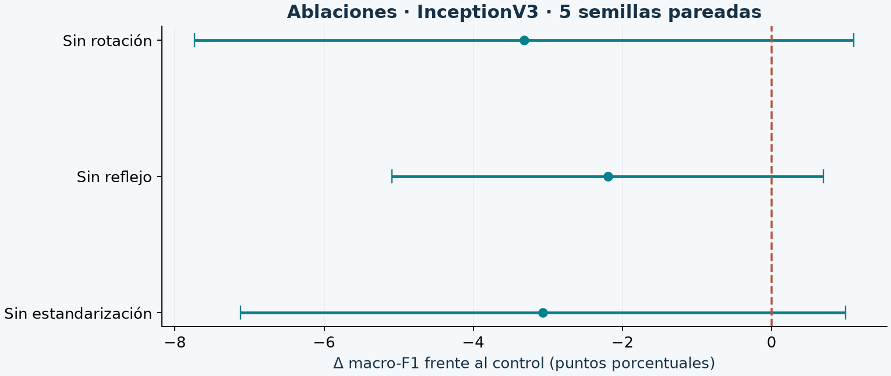
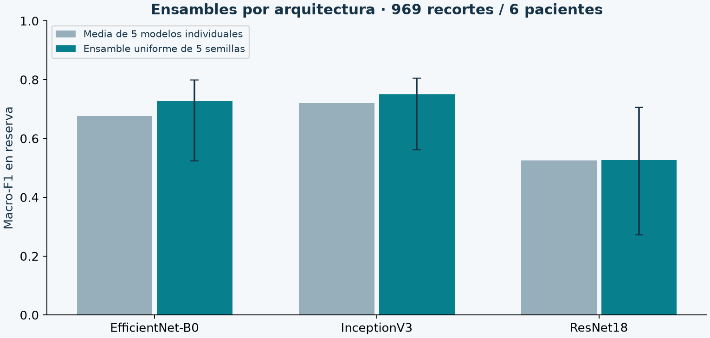
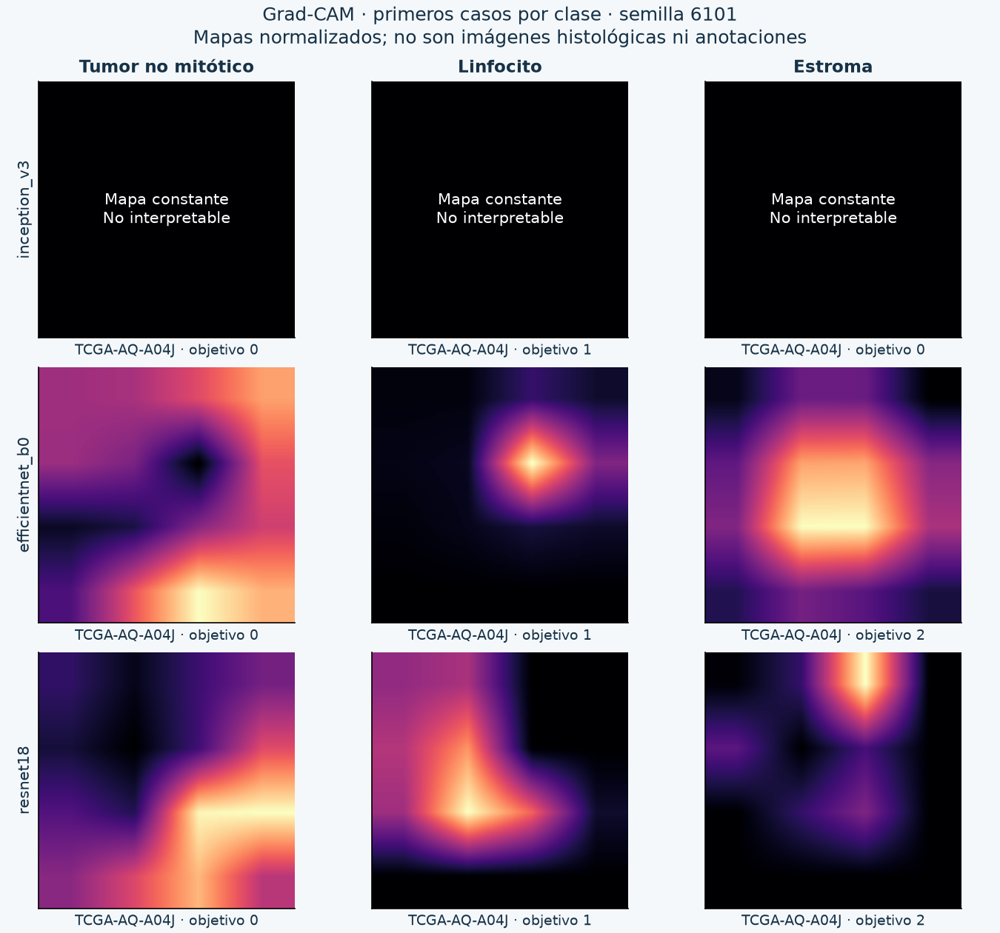
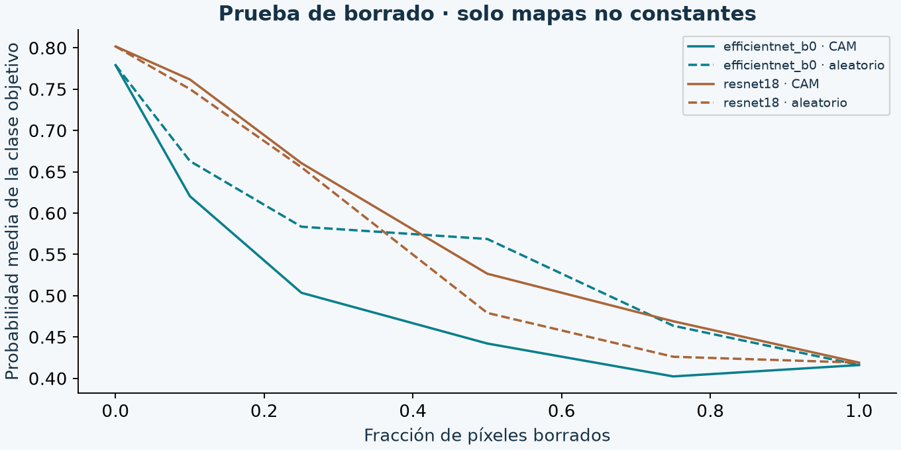

# Ablaciones, ensambles e interpretabilidad

**Actualización online · 16 de noviembre de 2026.** Esta ampliación documenta resultados posteriores al paquete entregado. Conserva el alcance de E2 y no sustituye el ZIP de la entrega. Los análisis de esta página no incorporan PCam.

## Tres componentes de InceptionV3

Se retiró por separado la rotación, el reflejo y la estandarización. Cada condición usa las cinco semillas 6101–6105, contrastadas con su control de la misma semilla. InceptionV3 fue seleccionado mediante validación. Se completaron **15 entrenamientos de ablación**, evaluados en los 2.049 recortes de validación; no se abrió la reserva para estas ablaciones.

| Condición | Δ macro-F1 | IC95 t de Δ | p t, Holm 3 | p Wilcoxon, Holm 3 |
|---|---:|---:|---:|---:|
| Sin rotación | -0,0332 | [-0,0774; 0,0110] | 0,3073 | 0,1875 |
| Sin reflejo | -0,0220 | [-0,0509; 0,0069] | 0,3073 | 0,3750 |
| Sin estandarización | -0,0307 | [-0,0712; 0,0099] | 0,3073 | 0,3750 |

El control tiene macro-F1 medio de **0,8235**. Las tres retiradas reducen el promedio, pero los intervalos incluyen cero y ninguna comparación supera la corrección de Holm. Estos datos no demuestran equivalencia ni permiten atribuir una mejora confirmada a cada componente. Los IC t son marginales, no simultáneos; cinco semillas ofrecen precisión limitada. Los tamaños de efecto y sus intervalos bootstrap se conservan en el CSV, con 1.997 remuestreos válidos de 2.000.

## Ensambles uniformes de semillas

Para cada una de las tres arquitecturas elegidas por validación se promediaron las probabilidades de sus cinco semillas congeladas. Son **tres ensambles separados**, no una mezcla de las tres arquitecturas. El análisis reutiliza probabilidades de la reserva heredada: no hubo nuevo entrenamiento, ajuste de pesos ni selección sobre ella.

| Arquitectura | Media individual | Ensamble | IC95 por paciente | ECE fijo 10 | Brier |
|---|---:|---:|---:|---:|---:|
| efficientnet_b0 | 0,6758 | 0,7275 | [0,5232; 0,7983] | 0,0842 | 0,2271 |
| inception_v3 | 0,7204 | 0,7496 | [0,5610; 0,8048] | 0,0689 | 0,1916 |
| resnet18 | 0,5260 | 0,5268 | [0,2721; 0,7061] | 0,1114 | 0,4743 |

Los intervalos proceden de 2.000 remuestreos agrupados por paciente: **969 recortes de seis pacientes**. Las mejoras frente a la media individual son descriptivas; no constituyen un contraste pareado de superioridad del ensamble. El ECE puede aumentar aunque mejore el macro-F1. Se publican también riesgo según retención, calibración por subgrupo y desacuerdo entre semillas. Este desacuerdo no identifica por sí solo incertidumbre epistémica; las listas de errores son propuestas para revisión, no diagnósticos humanos completados.

## Grad-CAM: validez y estabilidad de los mapas

Se analizaron 24 recortes de validación (ocho por clase, buscando pacientes distintos dentro de cada clase) en tres modelos y dos semillas: **144 mapas**. La clase objetivo se fija con la predicción de la semilla 6101 y se conserva para 6102. No siempre coincide con la anotación de referencia.

La figura muestra el primer caso seleccionado de cada clase para cada modelo, sin selección por apariencia favorable. Son mapas normalizados, no superposiciones histológicas. El cotejo de imágenes y anotaciones originales se consulta en la [galería histológica](12_galeria_histologica.md).

| Modelo | Mapas constantes | Pares con correlación definida | Correlación mediana entre semillas |
|---|---:|---:|---:|
| inception_v3 | 48/48 | 0/24 | No estimable |
| efficientnet_b0 | 0/48 | 24/24 | 0,5552 |
| resnet18 | 1/48 | 23/24 | 0,6642 |

**Los 48 mapas de InceptionV3 son constantes en la capa examinada (`Mixed_7c.branch_pool.conv`).** No sustentan una interpretación espacial ni una prueba válida de localización por borrado. Esto limita esta implementación de Grad-CAM; no invalida automáticamente las predicciones del clasificador. En ResNet18 hay un mapa constante; se excluye de la correlación y del resumen de borrado.

Se borran fracciones crecientes de píxeles, comparando el orden por atribución con un orden aleatorio fijo. La figura promedia únicamente mapas no constantes (48 de EfficientNet y 47 de ResNet18). Una caída mayor puede apoyar sensibilidad al área señalada, pero el borrado introduce imágenes fuera de distribución y no equivale a validación histológica. La diferencia media de área bajo la curva (aleatorio − CAM) es +0,0683 para EfficientNet y −0,0250 para ResNet18. El orden por CAM reduce más la probabilidad, en promedio, solo en EfficientNet; ResNet18 no muestra esa ventaja en este resumen. Son resultados descriptivos sobre casos seleccionados. La correlación entre semillas es descriptiva, sin prueba de estabilidad clínica.

## Prueba de sanidad del entrenamiento

InceptionV3 logró exactitud 1,0 en los controles de los pasos 60, 70 y 80 sobre 33 recortes de entrenamiento (11 por clase), superando el criterio de ≥0,99 en tres controles consecutivos. Es un control positivo de capacidad y funcionamiento del entrenamiento; no estima generalización ni ruido de etiquetas.

## Evidencia y comprobaciones

Se cotejaron 62 archivos descargados con las huellas SHA-256 de sus marcadores guardados. Las matrices de confusión de las 15 ablaciones reproducen sus macro-F1; los contrastes t y Wilcoxon se recalcularon con las semillas emparejadas. Esta comprobación no incluye una nueva descarga de los pesos.

- [Contrastes de ablación y efectos](../evidencias/experimentos_post_20261116/ablaciones_contrastes.csv).
- [Ablaciones por semilla y control](../evidencias/experimentos_post_20261116/ablaciones_por_semilla.csv).
- [Resumen de ensambles](../evidencias/experimentos_post_20261116/ensembles/resumen_ensembles.csv).
- [Riesgo y retención](../evidencias/experimentos_post_20261116/ensembles/riesgo_retencion.csv).
- [Resumen de Grad-CAM](../evidencias/experimentos_post_20261116/gradcam_resumen.csv).
- [Prueba de sanidad](../evidencias/experimentos_post_20261116/sanidad.json).
- [Manifiesto de esta actualización](../evidencias/experimentos_post_20261116/manifiesto.json).
